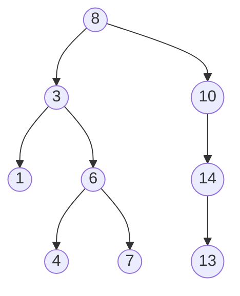
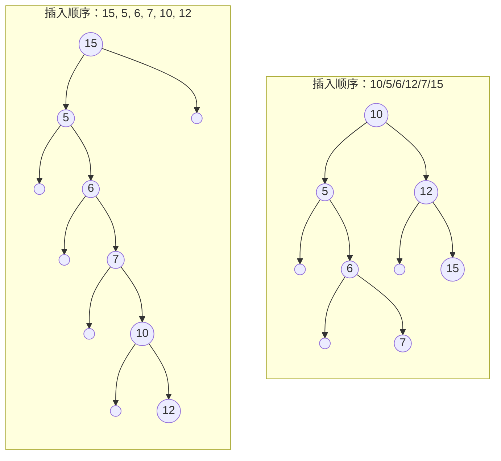
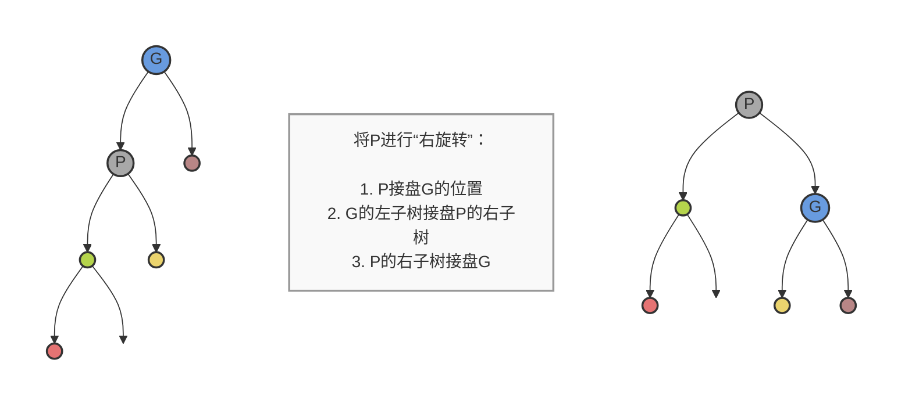
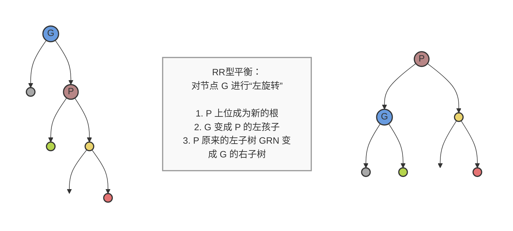
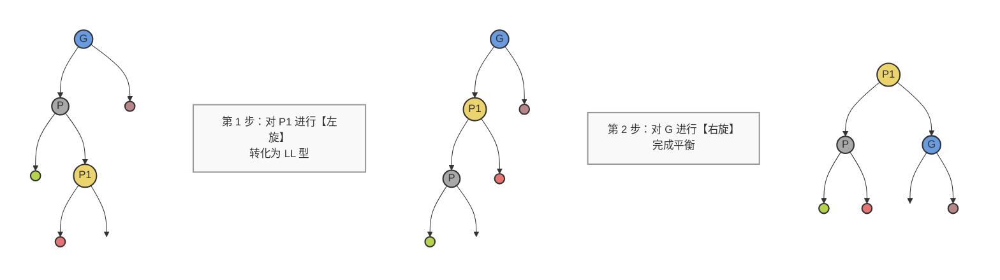
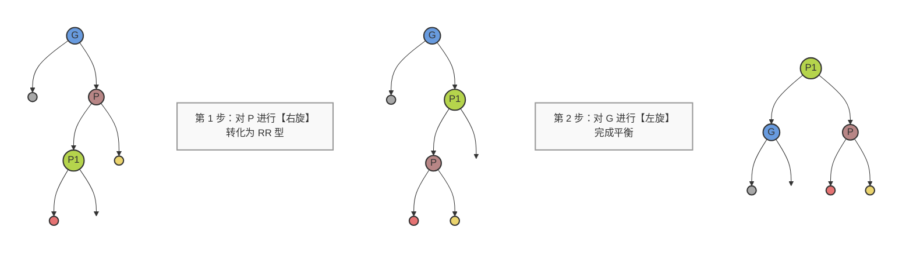

# 二叉排序树

一般排序树查找的次数是树的深度

假设我们有一棵二叉排序树，插入顺序为 `8, 3, 10, 1, 6, 14, 4, 7, 13`。

**对于同一组数据，不同的插入顺序，会形成不同深度的二叉树**

例如：15/5/6/7/10/12       10/5/6/12/7/15

不同的顺序引发不同的树的深度

## 平衡二叉树

\[
\left| \text{depth of left children} - \text{depth of right children} \right| \le 1
\]

## 平衡二叉排序树

## 1.Rotation – LL型平衡化旋转

---

## 2. RR型平衡化旋转

### Rotation – RR型平衡化旋转

## 3. LR型平衡化旋转

### Rotation – LR型平衡化旋转

## 4. RL型平衡化旋转

---

###  RL型平衡化旋转

